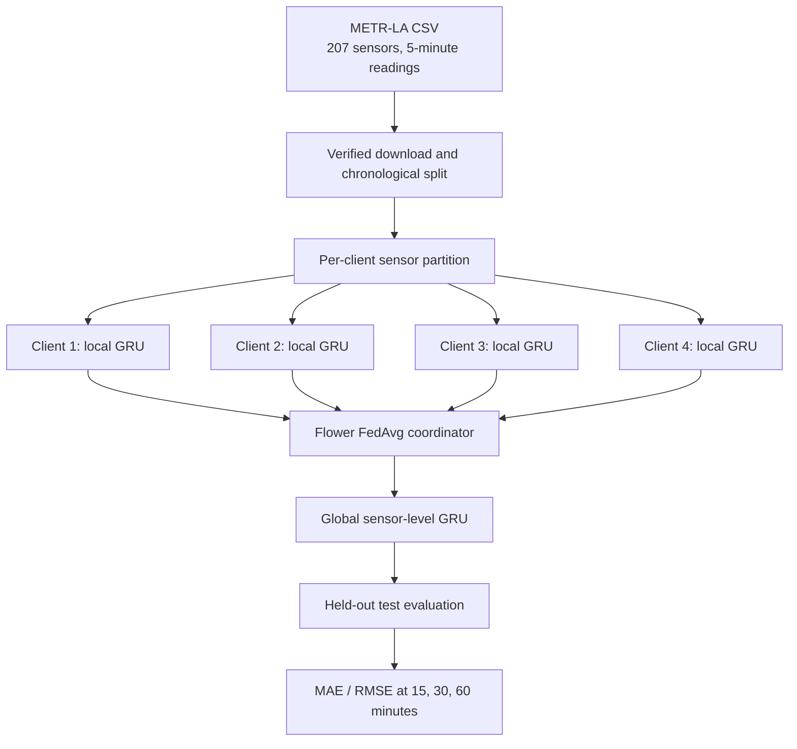
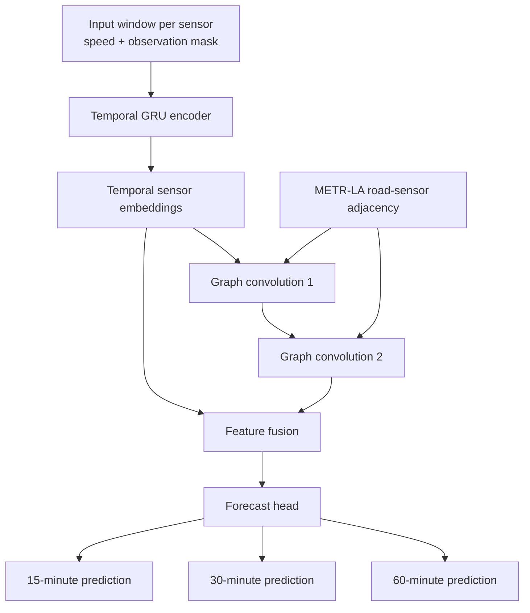

# FedRoad Architecture

## Current federated GRU pipeline

The current implementation uses Flower's simulated clients in one runtime. Sensor readings are partitioned across logical clients, and the server aggregates model parameters using FedAvg. This is a federated simulation, not a deployment across independently administered organizations. It does not by itself provide differential privacy or secure aggregation.

## Experimental directed spatio-temporal graph model

The graph-aware model is an experimental centralized candidate introduced in `fedroad/graph_model.py`. It combines per-sensor temporal representations with direction-preserving message passing using both forward and reverse random-walk transitions. The verified METR-LA adjacency is asymmetric, so this model does **not** silently symmetrize the graph. It is inspired by diffusion-based traffic models, but it is not a full reproduction of DCRNN. It is **not yet wired into Flower's federated ClientApp/ServerApp**. The earlier symmetric-GCN smoke run is a separate experiment and must not be mixed with results from this directed model.

## Data and evaluation controls

- The CSV download is checked against its published checksum; the adjacency file has a separate published checksum.
- Sensor columns are aligned by sensor ID to the adjacency matrix before graph training.
- Splits are chronological (70% train, 10% validation, 20% test).
- Normalization statistics are fitted on observed training readings only.
- Non-positive and non-finite readings are treated as unavailable under the project's documented preprocessing assumption. Observation masks exclude unavailable targets from loss and evaluation.
- Validation data is used for early stopping. Test metrics are for final evaluation only.

## Graph-data provenance

The adjacency file is `adj_mx_METR-LA.pkl`, published alongside METR-LA on [Zenodo record 5724362](https://zenodo.org/records/5724362). METR-LA and its sensor-graph conventions are associated with the DCRNN traffic-forecasting benchmark. See the [DCRNN repository](https://github.com/liyaguang/DCRNN) and the paper [Diffusion Convolutional Recurrent Neural Network](https://arxiv.org/abs/1707.01926).
