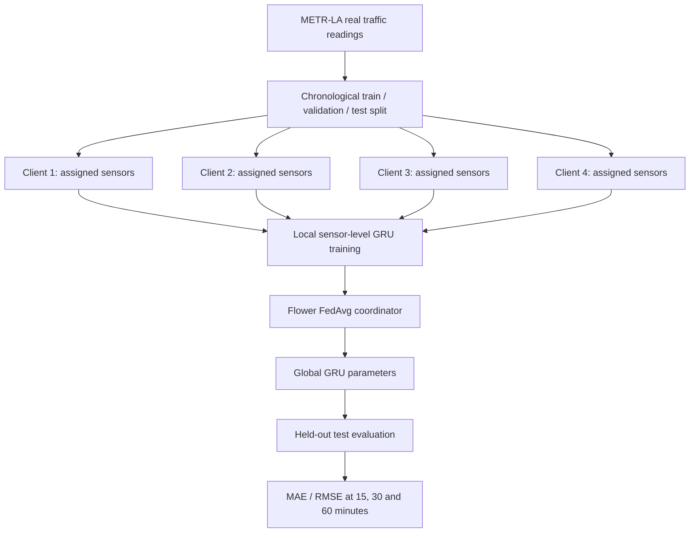

# FedRoad Architecture

## Core federated forecasting pipeline

## Model

The primary forecasting model is a PyTorch GRU. Each sensor's input is a 12-step sequence (60 minutes at five-minute sampling cadence), with normalized speed and an observation mask as two features. The model predicts three future speeds at 15, 30, and 60 minutes.

The centralized model is the benchmark. The federated version runs local training on four deterministic, non-overlapping sensor partitions, then aggregates compatible model parameters using Flower's FedAvg strategy. Each client calculates its own normalization statistics from its local training partition only.

## Data-quality handling

The METR-LA CSV has 34,272 rows and 207 sensor columns. Non-positive or non-finite observations are treated as unavailable in the current pipeline. The observation mask is retained, and unavailable targets are excluded from training loss and metrics. Preprocessing statistics are calculated on each training partition, not from the validation/test period.

## Scope and limitations

- The current Flower configuration simulates four clients in one runtime; the clients are not separate real-world traffic authorities.
- Keeping raw readings out of the aggregation function is not equivalent to a formal privacy guarantee. Secure aggregation and differential privacy are not currently enabled.
- Centralized and federated training budgets are not identical in the recorded experiments; use this as a first benchmark, not proof that federated learning is inherently superior.
- `fedroad/graph_model.py` and `fedroad/train_graph.py` are an experimental directed spatio-temporal model. The initial runs used a small smoke-test subset and are not included in the main benchmark until a full experiment has been completed.
